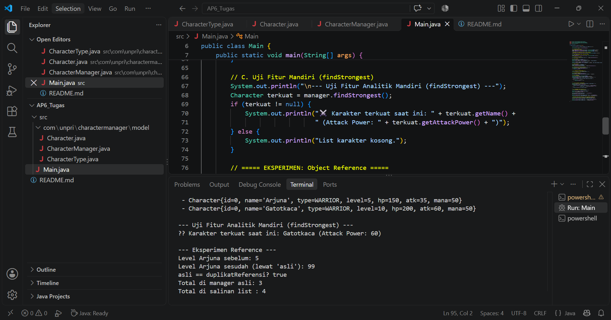

# Bagian C – Fitur Analitik Rancangan Sendiri.
Pada kelas CharacterManager, Saya menambahkan fitur analitik mandiri yaitu method findStrongest(). Method ini dirancang untuk memindai seluruh karakter yang tersimpan di dalam ArrayList<Character> dan mengembalikan objek Character yang memiliki nilai attackPower terbesar.
Rasionalitas & Penerapan Enkapsulasi:
•	Kegunaan Analitik: Fitur ini mempermudah sistem dalam menentukan pemain/karakter terkuat untuk keperluan statistik, arena battle, atau penentuan leaderboard.
•	Penanganan Kasus Khusus (Corner Cases): Jika characterList berada dalam keadaan kosong, method akan secara aman mengembalikan nilai null tanpa menyebabkan crash/IndexOutOfBoundsException.
•	Penerapan Enkapsulasi & Reference: Method ini mengembalikan reference ke objek Character yang ada atau null. Objek ArrayList<Character> utama (characterList) tetap tersembunyi dengan modifier private di dalam CharacterManager, sehingga struktur data internal tidak dapat diubah dari luar tanpa melalui mekanisme method yang sah.

## 📸 Screenshot Output Terminal



## 📁 Struktur Folder Project

```text
AP3_Tugas/
├── Screenshot 2026-10-16 011802.png
├── README.md
└── src/
    ├── Main.java
    └── com/
        └── unpri/
            └── charactermanager/
                └── model/
                    ├── Character.java
                    └── CharacterType.java

Nama    : Alyka Shakira Lubis
Nim     : (253303621239)
Kelas   : Semester 3 Pagi A
Link Google Docs : https://docs.google.com/document/d/1kwicniSes-rw6NbUpEToeQa9FSQC1E_l50XHLG52NxQ/edit?usp=sharing
